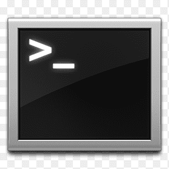

Command line tools for linguists is a course at the University of Helsinki that introduces students to command line as a tool to process linguistic data. This course focuses on navigating file systems, processing text and using regex.

Here are what the course went over week to week:

## Module 1

- we first learned how to list the current directory to know in which directory we are working in with **pwd**
- We then learned now to change directories with **cd** .
- After that we also focused on downloading files from the internet with **wget** . 
- If you have a text file, we learned that you can view it using **less**.
- We learned how to create files using **nano** or **touch** and directories using **mkdir** . 
- Removing them as well with **rm** and if its an empty directory **rmdir** . If its not empty then **rm -r**.
- Copying files is easy with **cp** and renaming and moving them with **mv**.
- We also learned now to find out and change read and write permissions for a file.

I found this part of the course very interesting because everything was new and we were learning fresh new commands.

## Module 2

In this second section, we learned about ASCII, Latin-1 and UTF-8 encodings and how to convert a text file from Latin -1 to UTF-8. We also learned now to convert Windows text files to UNIX format with **docs2unix**.

| Command | What it does |
| head | view the first lines of a file |
| tail | view the last lines of a file |
| wc -l | count the number of lines in a text file |
| tr 'A-Z' 'a-z' | change from uppercase to lowercase |
| sort | used to sort lines in alphabetical or numerical order |
| uniq | removes all duplicate lines |
| grep *or* egrep | search for patterns |

And of course with grep came learning to read and write with regex.
We learned how to save the output of a command directly to a file using **>**
To use all of these commands in sync we had to using piping **|** and we also learned how to use **sed** to delete lines and replace patterns.

Later in this section we learned how to make a frequency list out of words within a text file.
To do this, we had to also learn how to convert text into one word per line format and also learned how to do one sentence per line.

This was the heaviest part of the course but i thought it was the most useful when it came to learning how to handle documents with command line. It also deepened my understanding in general because we were practically applying what we learned.

## Module 3

In this section we were introduced to writing simple scripts. We learned about making loops and making if statements within scripts.
We learned that we can see the values of existing environment variables by using **echo** and that you can change their value and define new ones using **export**.
We also learned that the .bashrc / .bash_profile files can be modified to create a more pleasant working environment with shortcuts and other personalisations. 
This week we learned that you can give commands as the root user by using **sudo**.
We learned that you can install software by using **apt-get** or **brew** and that python packages can be installed by using **pip**.
We also learned how to make and run our own virtual environments.

Learning scripting was interesting but already having some python knowledge, I thought it was easy to get used to.

## Module 4

This week we learned how to kill a process.
We learned how to make a remote connection to a CSC server and to copy files to and from the server.
Next, we learned about version control and why it is important. After this, we learned and started working in Github. Within Github we learned how to clone repositories, create our own and start our own project by forking someone's template.

This was the most useful part of the course because we learned about the tools we need to build the final project.

## Final Project

This is the final project!!! 

For this project we needed to be able to navigate and write markdown files and create links to display on our website.

Enjoy!!!
