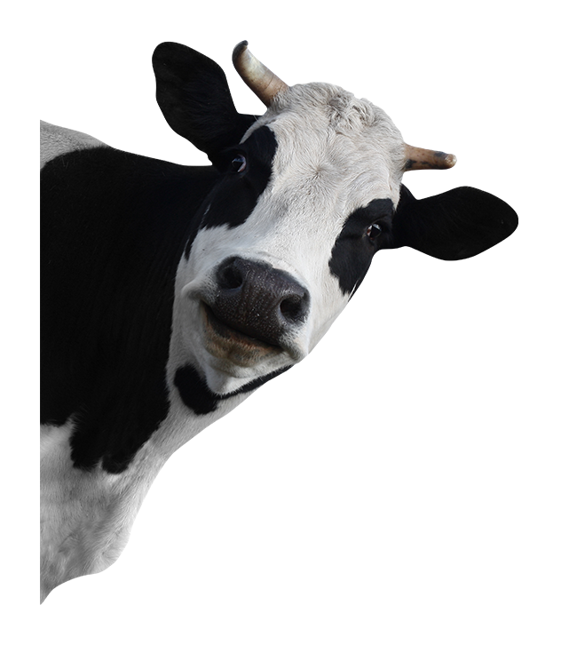

## Introduction

 My name is Alistar, also known as the Minotaur. I come from the proud Minotaur clans of the Great Barrier mountains, where I learned the importance of strength, loyalty, and honour. After being captured by the Noxian Empire and forced to fight as a gladiator, I escaped captivity and dedicated my life to protecting the innocent and fighting oppression.  
My greatest strengths include teamwork, resilience, and resolving conflicts with a well-timed headbutt. Outside of work, I enjoy travelling across Runeterra, exploring nature, physical training, and spending time with my fellow Minotaurs.

I am currently seeking opportunities where I can put my strength and leadership skills to good use, preferably somewhere that does not involve gladiatorial combat.

*Personal motto:* "You can't milk those!"

## Find me on

[LinkedIn](https://fi.linkedin.com/Alistar-Moo), [GitHub](https://github.com/echomay22)

**[Download my CV](assets/pdfs/Alistar_Moo.pdf)**

## Contact

Phone number: 1-800-GOT-MILK  
Email address: [alistar.moo@gotmilk.fi](mailto:rachel.turola@helsinki.fi) 

## Courses I've Taken

[Lactose intolerence and What Causes It](https://courses.helsinki.fi/Lactose-Intolerance), spring 2025

[Zebra Print VS Cow Print](https://courses.helsinki.fi/zebra-vs-cow), fall 2026

[Programming for Digital Humanities](https://studies.helsinki.fi/courses/course-unit/otm-76e485d6-7340-4bc1-97f4-9d4e1eb5e306), fall 2026

[Command Line Tools](https://studies.helsinki.fi/courses/course-unit/otm-92ee484e-456b-409f-a397-d9d2b6e40a2f), fall 2026

## Projects

[cmdline-course](https://github.com/echomay22/cmdline-course)  
This was a small project in which we learned how to add, commit and push files to Github. 
Above is the link to the project.

## Misc. 

[Why do Finns drink the most milk?](https://yle.fi/a/3-5315095)

[My real CV](https://www.leagueoflegends.com/en-gb/champions/alistar/)

**My favorite outfit**

 

**My Skills and Abilities**

